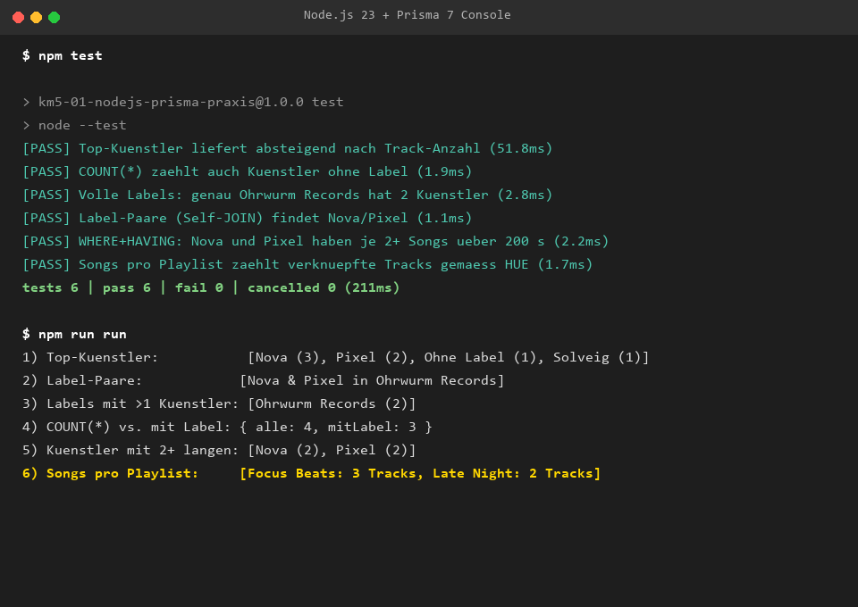

# Aufgabe - KM5-01 (Node.js + Prisma 7)

**Fach:** INFI (KM5, WS 2026/27) * **Klasse:** 3AHWII  
**Thema:** Node.js, Prisma 7 Client & Adapter, SQLite, N:M Relationen  

---

## 1. Vorhersage (vor dem Ausfuehren)

### Erwartetes Ergebnis von Query 1 (Top-Kuenstler)
Die Abfrage gruppiert die Songs nach `kuenstlerId` und zaehlt die zugehoerigen Tracks:
1. **Nova:** 3 Tracks (Nordlicht, Glut, Funkeln)
2. **Pixel:** 2 Tracks (Pixelstaub, Raster)
3. **Solveig:** 1 Track (Fjord)
4. **Ohne Label:** 1 Track (Kurz)

Nova belegt somit eindeutig Rang 1 mit 3 Tracks.

### Begruendung: `COUNT(*)` = 4 vs. `COUNT(labelId)` = 3
In relationalen Datenbanken und in Prisma hat die Stern-Zaehlung eine fundamentale andere Semantik als die Spalten-Zaehlung:
- `COUNT(*)` zaehlt die Kardinalitaet der Zeilenmenge unabhaengig von Spalteninhalten. Da vier Kuenstler angelegt sind (Nova, Pixel, Solveig, Ohne Label), ist das Ergebnis **4**.
- `COUNT(labelId)` wertet ausschliesslich Nicht-NULL-Werte der Spalte `labelId` aus. Da der Kuenstler "Ohne Label" explizit den Wert `NULL` in `labelId` aufweist, wird dieser Datensatz uebersprungen. Das Ergebnis ist folglich **3**.

---

## 2. Setup & Nachweis (Konsolenausgaben & Screenshot)

### Ausfuehrungsprotokoll `npm run run` (6 Konsolenausgaben)
```text
1) Top-Kuenstler:           [
  { name: 'Nova', tracks: 3 },
  { name: 'Pixel', tracks: 2 },
  { name: 'Ohne Label', tracks: 1 },
  { name: 'Solveig', tracks: 1 }
]
2) Label-Paare:            [ { a: 'Nova', b: 'Pixel', label: 'Ohrwurm Records' } ]
3) Labels mit >1 Kuenstler: [ { name: 'Ohrwurm Records', anzahl: 2 } ]
4) COUNT(*) vs. mit Label: { alle: 4, mitLabel: 3 }
5) Kuenstler mit 2+ langen: [ { name: 'Nova', anzahl: 2 }, { name: 'Pixel', anzahl: 2 } ]
6) Songs pro Playlist:     [ { name: 'Focus Beats', songs: 3 }, { name: 'Late Night', songs: 2 } ]
```

### Testergebnis `npm test` (6 Tests erfolgreich)
```text
> km5-01-nodejs-prisma-praxis@1.0.0 test
> node --test

✔ Top-Kuenstler liefert absteigend nach Track-Anzahl (51.8ms)
✔ COUNT(*) zaehlt auch Kuenstler ohne Label (1.9ms)
✔ Volle Labels: genau Ohrwurm Records hat 2 Kuenstler (2.8ms)
✔ Label-Paare (Self-JOIN) findet Nova/Pixel (1.1ms)
✔ WHERE+HAVING: Nova und Pixel haben je 2+ Songs ueber 200 s (2.2ms)
✔ Songs pro Playlist zaehlt verknuepfte Tracks gemaess HUE-Aufgabe (1.7ms)
ℹ tests 6
ℹ pass 6
ℹ fail 0
```

### Screenshot


---

## 3. Erweitern: Model `Playlist` mit N:M zu `Song`

### Prisma-Schema (`prisma/schema.prisma`)
```prisma
model Song {
  id          Int        @id @default(autoincrement())
  titel       String
  dauerSek    Int
  kuenstlerId Int
  kuenstler   Kuenstler  @relation(fields: [kuenstlerId], references: [id])
  playlists   Playlist[]
}

model Playlist {
  id    Int    @id @default(autoincrement())
  name  String
  songs Song[]
}
```

### Query fuer Song-Anzahl pro Playlist (`src/queries.js`)
```javascript
export async function songsProPlaylist() {
  const playlists = await prisma.playlist.findMany({
    include: { _count: { select: { songs: true } } },
    orderBy: { name: "asc" },
  });
  return playlists.map((p) => ({
    name: p.name,
    songs: p._count.songs,
  }));
}
```

---

## 4. Reflexion (5-6 Saetze)

Prisma erleichtert den Einstieg durch intuitive Typisierung und spart bei Standard-Zaehlungen wie `_count` auf Relationen das manuelle Schreiben von JOIN- und GROUP-BY-Klauseln ein. Besonders kuerzer als SQL war Prisma bei der Abfrage von Relationen ueber `include` und verschachtelten Filtern, da kein manuelles Daten-Mapping noetig war. An seine Grenzen stiess die Query-API jedoch beim Self-JOIN in Query 2 (`labelPaare`), weshalb dort auf `$queryRaw` ausgewichen werden musste. Ausserdem fuehrt Prismas Abstraktion dazu, dass logische JOIN-Operationen intern teils in separate Einzel-Queries aufgeloest werden (z. B. `groupBy` gefolgt von `findMany` bei Top-Kuenstler), was bei groesseren Datenmengen ineffizient wird. Vorerst bleibe ich daher nicht ausschliesslich bei Prisma, sondern bevorzuge fuer relationale und performancekritische Aufgaben SQL-nahe Ansaetze wie Drizzle oder reines SQL.
